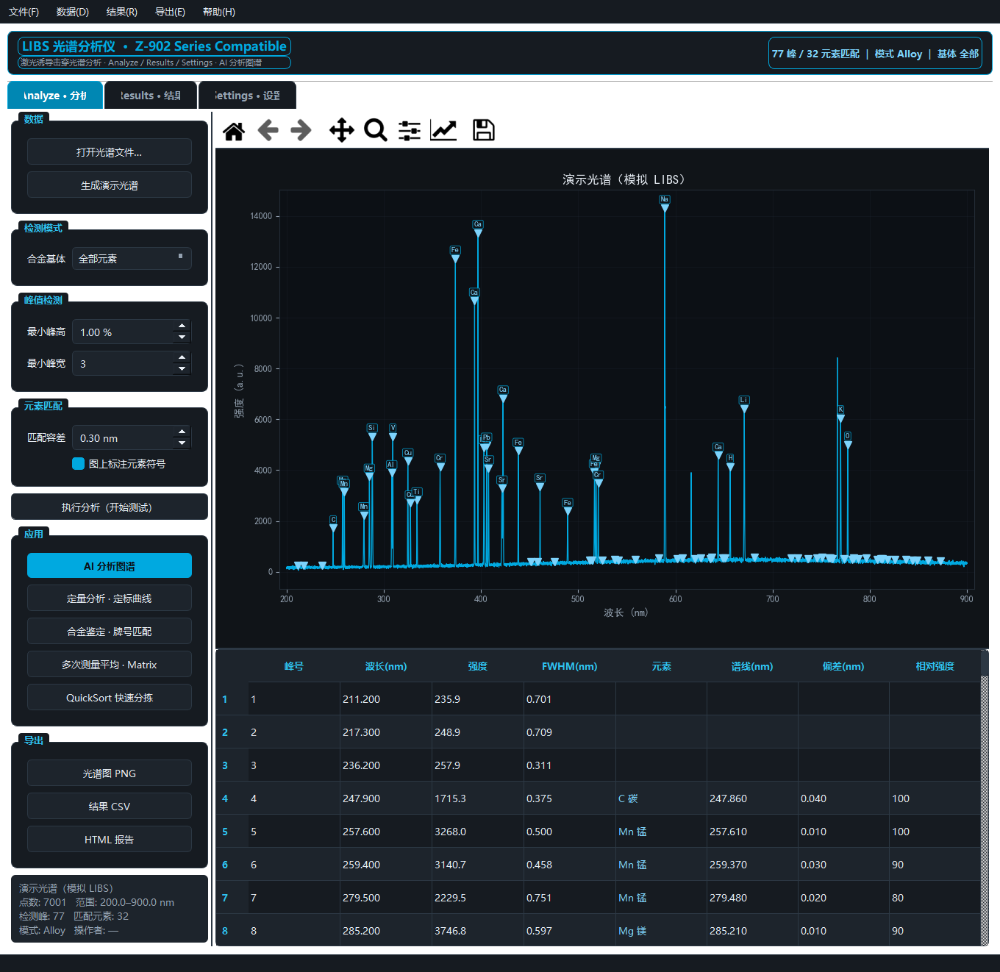
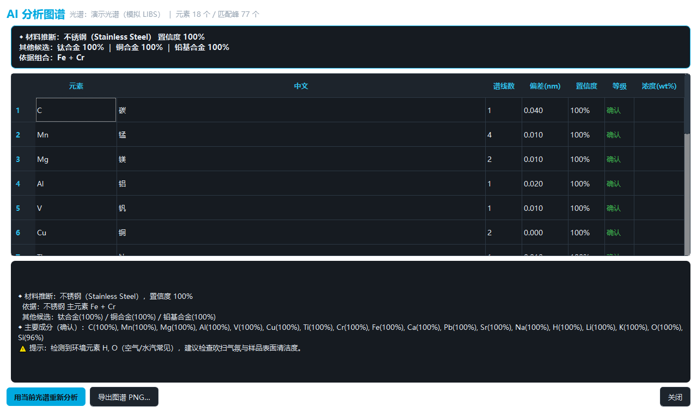
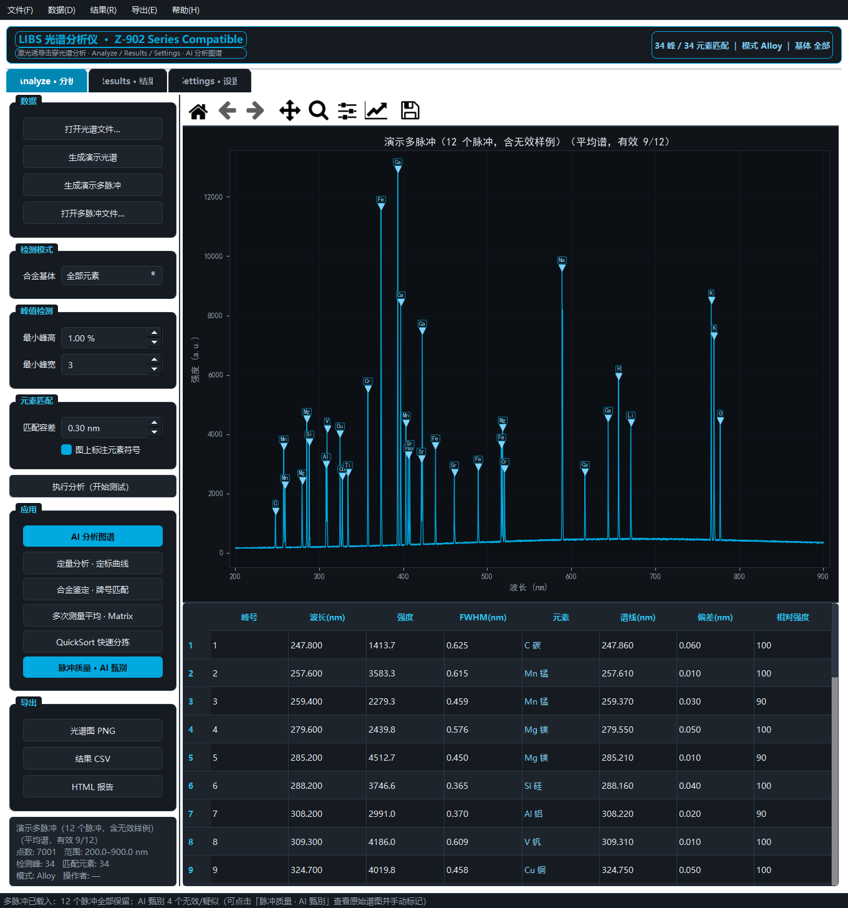
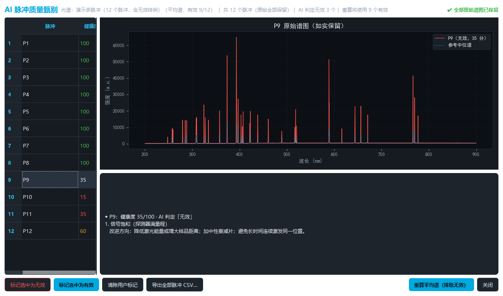

# Libs通用测试软件（LIBS General Testing Software）

基于 **PyQt5** 的激光诱导击穿光谱（LIBS）桌面分析软件：从光谱读取、元素定性到定量定标、合金牌号鉴定、AI 智能图谱、无效脉冲甄别的一站式工具。界面与功能参照 SciAps Z-902 手持 LIBS 分析仪，深色工业风格。

> ⚠️ 本仓库**不含** SciAps 商标、Logo 或官方素材；软件按“现状”提供，分析结果仅供科研参考。

## ✨ 功能亮点

| 模块 | 说明 |
|---|---|
| 光谱分析 | 波长-强度曲线、峰值检测（可调阈值）、40 元素 NIST 谱线匹配、图上元素标注 |
| 多脉冲甄别 | 一次测量全部激光脉冲**原始谱图如实保留**；AI 自动识别无效脉冲（饱和/弱信号/高噪声/漂移/不一致）并**提示客户改进方向**；用户可逐条查看、手动标记无效/有效，排除后重算平均谱 |
| 定量分析 | 定标曲线法（方程/R²/标准误/95% 区间），定标持久化保存，可反推未知样浓度 |
| 合金鉴定 | Chemistry 浓度表 + Grade Match 100 分制牌号匹配（30+ 常见牌号，支持用户自定义） |
| AI 分析图谱 | 元素置信度评分 + 材料/基体推断 + 元素-材料关系图谱 + 置信度条形，本地离线运行 |
| 数据管理 | 测试历史记录、多次测量平均（AVG/SD/RSD）、QuickSort 快速分拣、HTML 报告、Excel 模板导出 |
| 多方法切换 | Profile 管理：操作者/基体/检测参数/ND 规则一键应用 |

## 🖥 界面预览

| 主界面 | AI 分析图谱 |
|---|---|
|  |  |

| 多脉冲载入 | 脉冲质量 · AI 甄别 |
|---|---|
|  |  |

## 🚀 快速开始

Windows 用户可直接下载 **Release 中的免安装版 `LibsAnalyzer.exe`**（约 670MB，已内置全部依赖，无需安装 Python，双击即运行；首次启动解压需等待 10–60 秒，运行数据自动保存在 exe 同目录 `data\`）。

源码运行：

```bash
# 1. 安装依赖（Python 3.8+，推荐 Anaconda3）
pip install -r requirements.txt

# 2. 运行
python run.py
```

Windows 用户可直接双击 `run.bat`。首次启动自动生成演示光谱与测试记录。

## 📁 项目结构

```
LIBS_Analyzer/
├── run.py / run.bat            # 启动入口
├── libs_analyzer/              # 核心模块（主窗口/谱线库/峰检测/数据IO/定量/牌号/AI/脉冲质量…）
├── tests/                      # 单元测试（65 项）
└── _selfcheck/                 # GUI 冒烟自检脚本（含真实窗口验证）
```

## ✅ 自检

- 单元测试：65 项全部通过（数据/峰检测/匹配/定量/牌号/记录/CE/AI 图谱/脉冲质量）
- GUI 冒烟：三大模块、AI 图谱、脉冲甄别、Excel/HTML 导出均 PASS

```bash
python -m unittest discover -s tests
```

## 📄 许可

[GNU GPL v3](LICENSE)（或更新版本）。修改再分发须保持开源并保留许可声明。
